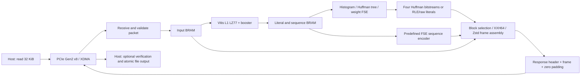

# FPGA entropy accelerator architecture

## Pipeline

The diagram shows data dependencies. The entropy stages execute sequentially;
they are not independent concurrent engines. Only the LZ77 subpipeline uses
HLS DATAFLOW. The complete fixed-size request is consumed before compression,
so the host can finish its blocking H2C write before starting its C2H read.

## Source organization

| Source | Responsibility |
| --- | --- |
| `hls/zstd_accel.cpp` | AXI protocol, LZ77 dataflow, token collection, response |
| `hls/entropy.hpp` | Histogram, Huffman tree, weight encoding, FSE, frame assembly |
| `hls/checksum.hpp` | Hardware XXH64 content checksum |
| `hls/fse_tables.hpp` | Generated constant FSE encoder ROMs |
| `scripts/generate_fse_tables.py` | Reproducible ROM generator |
| `hls/protocol.hpp` | Shared sizes, signatures, FPGA identity |
| `host/fpga_zstd.cpp` | XDMA transport, response checks, file publication |
| `host/transport.hpp` | Response validation and bounded framing-error recovery |
| `scripts/create_design.tcl` | PCIe shell, clock/reset crossings, board peripherals |

## Match representation

The pinned Vitis L1 `lzCompress` and `lzBooster<255>` functions produce 32-bit
tokens. A literal occupies the low byte. A match has an 8-bit length and a
16-bit offset-minus-one. The collector stores literals in source order and
records `(literal_count, match_length, distance)` for each sequence. There is
no explicit trailing-literal sequence: those literals are accounted for by
the regenerated literal-section size and sequence execution.

The history window and maximum request are 32768 bytes. The minimum match is
3 bytes and maximum boosted match is 255 bytes. At most `32768 / 3 + 1`
sequence slots are allocated. The collector checks distances, source coverage,
and sequence/literal bounds. Blocks of at most 128 bytes bypass the Vitis
match finder and still pass through the hardware frame encoder.

## Literal entropy coding

A 256-entry histogram feeds a sequential Huffman tree builder. Each merge
selects the two least frequent active nodes; child depths produce code lengths.
Codes follow Zstd's canonical rank ordering, with longest codes assigned first.
A depth above 11 selects raw literals rather than an invalid or truncated tree.
A single-symbol histogram uses the standard RLE literals representation.

The last nonzero Huffman weight is implicit in the format. If at most 128
weights need serialization, the encoder writes direct four-bit weights. Larger
alphabets use two interleaved FSE states over weights 0 through 11, with table
log 5 and distribution `[8,8,4,2,2,2,1,1,1,1,1,1]`. Its normalized count header
is included in every such table. A weight encoding that cannot fit the Zstd
127-byte compressed-header limit causes raw-literal fallback.

Four literal streams traverse their segments in reverse. The first three
compressed lengths form the six-byte jump table. Compressed literal headers
use the standard five-byte form with 18-bit regenerated and compressed sizes.
The encoder compares the complete Huffman section, including table and jump
overhead, with a raw section before choosing it.

## Sequence entropy coding

The FPGA maps literal and match lengths to Zstd's LL and ML codes, and encodes
physical distance as `offset_value = distance + 3`. Repeat-offset codes are
not used. Predefined distributions use table logs LL=6, ML=6, OF=5. Generated
ROMs contain state transitions, symbol transforms, and initial states.

Sequences are visited in reverse order. The last sequence initializes the
three states; subsequent symbols update OF, ML, then LL. Extra bits are appended
LL, ML, then OF. Final states flush ML, OF, then LL, followed by the reverse
bitstream end marker. The decoder consequently reads the specified inverse
order. The sequence mode byte is zero (all three predefined tables).

The bit accumulator emits little-endian bytes, with at most 16 new bits per
call. These functions are shared by portable tests and HLS synthesis. No
libzstd source or host-callable compression function is in the hardware path.

## Frames, storage, and scheduling

Each transaction yields one standard single-segment Zstd frame containing one
last block, with a content-size field, an XXH64 content checksum, and no dictionary. Content
sizes 256 through 32768 use the required minus-256 bias. Smaller sizes use the
one-byte size representation. Empty input uses a zero-length raw block.

Hardware compares the complete candidate block payload with the original
input. A compressed block is used only if smaller; otherwise a raw block is
copied from input BRAM. Frame size is therefore at most `input_size + 14`.
The 64 KiB response capacity also accommodates intermediate entropy buffers.
Arrays use Kintex-7 BRAM; the prepared Vitis include tree maps URAM pragmas to
BRAM without modifying the vendored source. A sequential XXH64 unit hashes the original bytes with seed zero, using
64-bit wrapping arithmetic and explicitly pipelined four-cycle DSP multipliers,
and appends its low 32 bits to the frame. This
preserves the reference design's checksummed output without host encoding.
A new frame resets all entropy
state. No table, match history, or repeat offset carries between transactions.

## PCIe protocol (version 3)

All fields and payload lanes are little endian. All beats have TKEEP and TSTRB
`0xffff`. TLAST is asserted only on the final padded payload beat. Padding is
included in DMA sizes but excluded from frame length.

| Direction | Header word 0 | Word 1 | Word 2 | Word 3 | Payload |
| --- | --- | --- | --- | --- | --- |
| H2C | `0x3354535a` (`ZST3`) | Input bytes, 0..32768 | Request tag | Reserved, zero | 32768 bytes, zero-padded by host |
| C2H | `0x3352535a` (`ZSR3`) | Valid frame bytes | Echoed tag | Status | 65536 bytes, zero-padded by FPGA |

Requests are **32784 bytes / 2049 beats**; responses are **65552 bytes / 4097
beats**. The FPGA drains every fixed-length request, including an invalid one.
Status 1 indicates bad signature, size, or reserved fields; 2 indicates bad
byte enables or TLAST placement; 3 indicates an invalid LZ token stream. On
error the frame length is zero and the entire response payload is zero. An
error is followed by normal handling of the next complete request. A truncated
request has no timeout in the core and must be cleared by reset/reprogramming.

The AXI GPIO second channel at BAR offset `0x8` exposes identity `0x5a534533`
(`ZSE3`). It differs from the reference LZ-only design. The host checks identity,
response signature, tag, status, length, and frame content size. With `--verify`
it also decompresses and compares every byte before writing the final file.

The pinned XDMA driver can split one H2C write at its 2048-descriptor ring
boundary. `transfer_init()` sets EOP on each internal transfer, so a split
inserts an extra TLAST inside the request. The core rejects it with status 2
after draining all request bytes and returns a complete zero-payload response.
The host validates the signature, tag, zero frame length, and zero payload,
then resends the same request once. Input position, output position, and tag
advance only after success. A second error is fatal. Short DMA transfers and
malformed responses are never retried because complete draining is unconfirmed.
This recovery works with the original bitstream and unmodified XDMA driver.

## Clocks and reset

The retained shell uses XDMA's 128-bit AXI stream clock and the board's 50 MHz
oscillator for the compressor. Asynchronous AXI stream FIFOs cross between
clock domains. A `proc_sys_reset` instance drives the active-low compressor
reset. `ap_start` is tied high; `ap_ctrl_hs` restarts the core for the next
packet after each response. GPIO LEDs, the LM73 I2C interface, and JTAG AXI
access remain as in the reference shell.

Vivado's implementation gate checks final setup, hold, and bus-skew timing
before publishing `build/accelerator.bit` and `.xsa`. HLS timing estimates alone
do not demonstrate routed timing closure.
